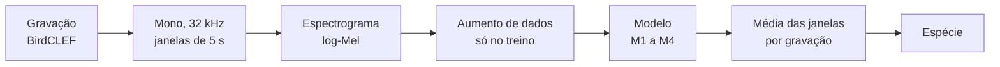
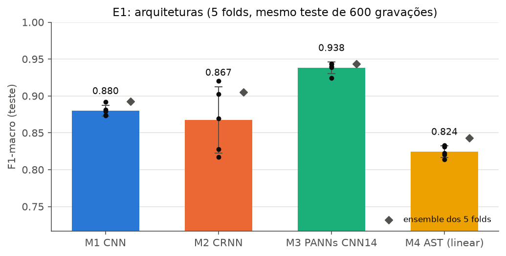
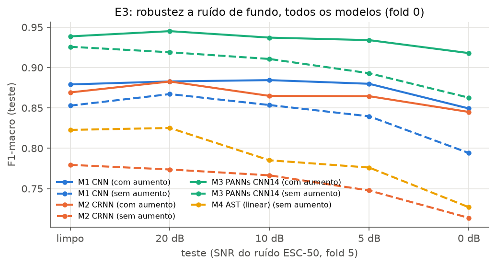
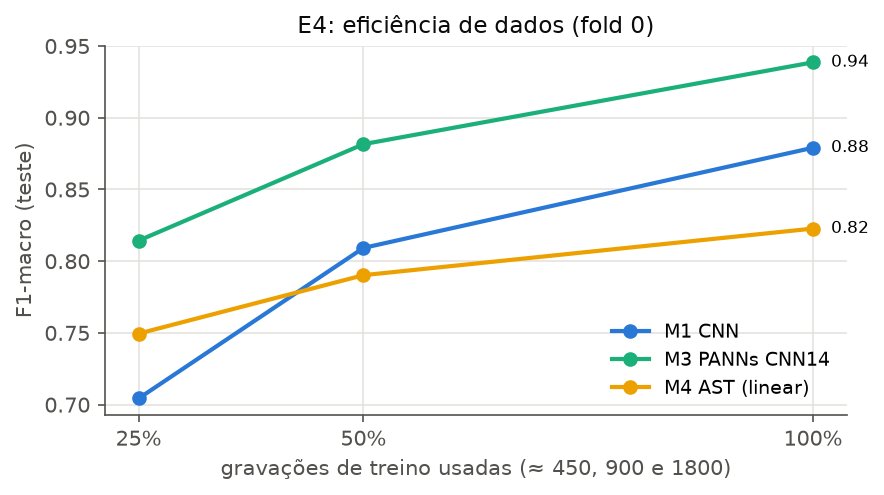
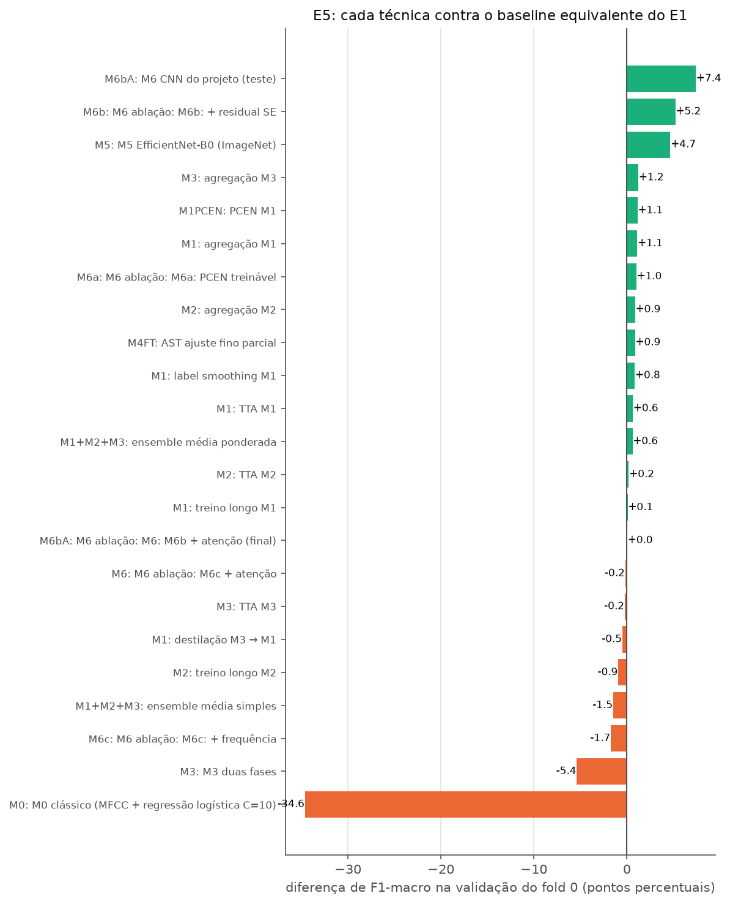

# birdclef-dl
Classificação de aves pelo canto (BirdCLEF, Kaggle) — projeto de Deep Learning, UFPE 2026.2

Projeto da disciplina CIN0040 Introdução à Aprendizagem Profunda (Prof. Tsang Ing Ren).
A proposta completa está em [proposta/main.pdf](proposta/main.pdf) (fonte em `proposta/main.tex`).
Este README resume o plano; em caso de divergência, vale a proposta.

## Objetivo

Identificar a espécie de uma ave a partir de trechos de 5 s do canto, comparando uma CNN e uma
CRNN treinadas do zero com modelos de áudio pré-treinados no AudioSet, e medindo o efeito do
aumento de dados na robustez a ruído.

**Hipóteses**

- **H1:** os pré-treinados (M3, M4) superam os treinados do zero (M1, M2) em F1-macro,
  sobretudo nas espécies com poucas gravações.
- **H2:** a CRNN (M2) supera a CNN (M1) de mesmo porte.
- **H3:** o aumento de dados reduz a queda de desempenho sob ruído (SNR ≤ 10 dB).

## Pipeline



| Etapa | Configuração |
|---|---|
| Subconjunto | 15 a 20 espécies com mais gravações, até ~150 gravações por espécie, priorizando qualidade |
| Janelas | 5 s, sobreposição de 50% no treino; janelas de energia muito baixa descartadas (rótulo fraco) |
| log-Mel (M1, M2) | 32 kHz, 128 bandas, 50 Hz a 14 kHz |
| log-Mel (M3, PANNs) | 32 kHz, 64 bandas (configuração original do PANNs) |
| log-Mel (M4, AST) | 16 kHz, 128 bandas (configuração original do AST) |
| Inferência | média das probabilidades das janelas de cada gravação |

## Modelos

| ID | Arquitetura | Inicialização |
|---|---|---|
| M1 | CNN, 4 blocos Conv-BN-ReLU-Pool + pooling global | aleatória |
| M2 | CRNN: blocos convolucionais + GRU bidirecional no eixo do tempo | aleatória |
| M3 | PANNs CNN14 | AudioSet |
| M4 | Audio Spectrogram Transformer, congelado + camada linear (o ajuste fino completo não cabe em 4 GB) | AudioSet |

No E5 entram ainda, como comparação: M0 (MFCC + classificador clássico, sem rede), M5 (EfficientNet-B0
do ImageNet), M4FT (AST com os 2 últimos blocos ajustados) e o M1 com PCEN na entrada.

Todos: softmax sobre as espécies, entropia cruzada, AdamW, parada antecipada pelo F1-macro de
validação.

**Aumento de dados:** SpecAugment (máscaras de tempo e frequência), mixup e mistura de ruído de
fundo da ESC-50 (chuva, vento, insetos).

## Protocolo experimental

Toda divisão é **agrupada por gravação**: janelas da mesma gravação nunca ficam em partições
diferentes. Teste fixo com 20% das gravações (estratificado por espécie), usado só na avaliação
final; nos 80% restantes, validação cruzada estratificada e agrupada com k = 5.

| Experimento | O que mede | Hipótese |
|---|---|---|
| E1 Arquiteturas | M1 a M4, mesma configuração de aumento, 5 folds | H1, H2 |
| E2 Ablação de aumento | sem aumento, cada técnica e todas, no melhor do zero e no melhor pré-treinado; 1 fold, 3 sementes | |
| E3 Robustez a ruído | teste corrompido com ESC-50 em SNR de 20, 10, 5 e 0 dB, com e sem aumento | H3 |
| E4 Eficiência de dados | treino com 25%, 50% e 100% das gravações, do zero contra pré-treinado | H1 |

**Métricas:** F1-macro (principal), acurácia top-1 e top-3, mAP, matriz de confusão; média ±
desvio entre folds ou sementes. Análise qualitativa com Grad-CAM nos espectrogramas e t-SNE dos
embeddings.

## Parte 1: dados, pipeline e M1

Implementada em `src/birdclef/` e nos notebooks `01` a `03`.

| Etapa | Onde | O que foi feito |
|---|---|---|
| Subconjunto | `dados.py`, `01_eda` | 20 espécies de aves com mais gravações do xeno-canto com nota ≥ 4; 150 gravações por espécie (3000 no total) |
| Divisões | `dados.py`, `01_eda` | teste fixo de 20% (600 gravações) estratificado; 5 folds estratificados nos 80% restantes; semente 42; janelas herdam a partição da gravação |
| log-Mel | `preproc.py`, `02_preprocessamento` | até 12 janelas de 5 s por gravação (passo 2,5 s), descarte de janelas 20 dB abaixo da mais forte; 128 × 313 em dB (ref. fixa), float16; 23 635 janelas |
| Aumento | `aumento.py` | SpecAugment (2 máscaras de freq. ≤ 16 bandas, 2 de tempo ≤ 40 quadros), mixup (α = 0,4), ruído ESC-50 folds 1-4 (p = 0,5, SNR 0-20 dB, somado em potência) |
| Teste ruidoso | `aumento.py` | teste refeito com ruído ESC-50 fold 5 (nunca visto no treino), misturado na forma de onda a 20, 10, 5 e 0 dB |
| Treino | `treino.py` | sorteio com peso 1/(janelas da gravação), AdamW (lr 1e-3), cosseno, precisão mista, até 30 épocas, parada antecipada (paciência 6) pelo F1-macro de validação por gravação |
| M1 | `modelos.py` | 4 blocos Conv3×3-BN-ReLU-MaxPool (32-64-128-256), média na frequência, média + máximo no tempo, dropout 0,3; 393 mil parâmetros |
| E2, E3 | `experimentos.py`, `graficos.py`, `03_m1_experimentos` | ver Resultados |

Para rodar localmente: `python -m birdclef.experimentos [e2|e3|tudo]` e `python -m birdclef.graficos`.

### Resultados (M1, fold 0 de validação, 3 sementes, média ± desvio)

Rodado numa RTX 3050 Laptop (4 GB): ~10 min por treino, 17-20 s por época.

**E2: aumento de dados** (`resultados/e2/`)

| Aumento | F1-macro val. | F1-macro teste | Top-1 teste | Top-3 teste | mAP teste |
|---|---|---|---|---|---|
| sem | 0,825 ± 0,011 | 0,844 ± 0,008 | 0,843 ± 0,009 | 0,944 ± 0,011 | 0,903 ± 0,003 |
| SpecAugment | 0,846 ± 0,012 | 0,870 ± 0,009 | 0,870 ± 0,008 | 0,953 ± 0,003 | 0,921 ± 0,004 |
| mixup | 0,836 ± 0,005 | 0,872 ± 0,002 | 0,872 ± 0,001 | 0,951 ± 0,005 | 0,923 ± 0,003 |
| ruído | 0,858 ± 0,004 | **0,882 ± 0,006** | **0,881 ± 0,005** | **0,963 ± 0,003** | 0,928 ± 0,005 |
| todas | 0,857 ± 0,001 | 0,876 ± 0,005 | 0,874 ± 0,004 | 0,959 ± 0,005 | **0,932 ± 0,007** |

Cada técnica sozinha melhora o M1 em 2,6 a 3,8 pontos de F1-macro no teste; o ruído de fundo é a
melhor isolada, e combinar as três não soma os ganhos (fica entre as isoladas, com o maior mAP).
Com aumento, a maioria dos treinos ainda melhorava na época 30, então há espaço para treinar mais.

**E3: robustez a ruído** (`resultados/e3/`): F1-macro no teste com ruído da ESC-50 (fold 5)

| Aumento | limpo | 20 dB | 10 dB | 5 dB | 0 dB | queda limpo → 0 dB |
|---|---|---|---|---|---|---|
| sem | 0,844 | 0,847 | 0,837 | 0,818 | 0,786 | −5,8 pontos |
| todas | 0,876 | 0,881 | 0,871 | 0,867 | 0,839 | −3,7 pontos |

O aumento reduz a queda sob ruído forte (SNR ≤ 5 dB), a favor de H3: a 5 dB o modelo com aumento
perde 0,9 ponto e o sem aumento perde 2,6. A 0 dB o modelo com aumento ainda fica no nível do sem
aumento no teste limpo.


## Parte 2: resultados

Notebooks [04_parte2_modelos](notebooks/04_parte2_modelos.ipynb) (M2, M3, M4, E1 a E4 e
análises) e [05_melhorias](notebooks/05_melhorias.ipynb) (E5), salvos com as saídas. Cada etapa
traz o que é feito, por que e como ler o resultado, seguido de uma leitura dos números. Rodado
numa RTX 3050 Laptop (4 GB de VRAM, 7,7 GB de RAM). Todos os números são F1-macro no **teste fixo
de 600 gravações**, salvo indicação.

**Modelos da Parte 2**

| ID | O que é | Parâmetros treináveis | Entrada |
|---|---|---|---|
| M2 | CRNN: 4 blocos convolucionais + GRU bidirecional, mesmo porte do M1 | 375 mil | log-Mel 128 × 313 |
| M3 | PANNs CNN14 pré-treinada no AudioSet, ajuste fino completo (lr 1e-4 no corpo, 1e-3 na cabeça, lote 16) | 79,7 milhões | log-Mel 64 × 501 (config. do PANNs) |
| M4 | AST pré-treinado no AudioSet, **congelado**, + camada linear (*linear probe*; o ajuste fino completo não cabe em 4 GB) | 15 mil | embedding de 768 dimensões |

**E1: arquiteturas, 5 folds, mesmo aumento** (`resultados/e1/`)

| Modelo | F1 val. | F1 teste (média ± desvio, 5 folds) | Ensemble dos 5 | Top-3 (ensemble) | min/treino |
|---|---|---|---|---|---|
| M1 CNN | 0,868 | 0,880 ± 0,008 | 0,893 | 0,973 | 11 |
| M2 CRNN | 0,865 | 0,867 ± 0,045 | 0,905 | 0,980 | 9 |
| **M3 PANNs** | **0,929** | **0,938 ± 0,008** | **0,944** | **0,992** | 49 |
| M4 AST congelado | 0,828 | 0,824 ± 0,008 | 0,843 | 0,952 | 0,1 |

Comparações pareadas (diferença por fold e *bootstrap* pareado dos ensembles, 5000 reamostras):

| A − B | dif. por fold | A melhor em | dif. ensembles [IC 95%] |
|---|---|---|---|
| M3 − M1 | +0,058 | 5 de 5 | +0,051 [+0,029; +0,076] |
| M3 − M2 | +0,071 | 5 de 5 | +0,038 [+0,017; +0,060] |
| M4 − M1 | −0,056 | 0 de 5 | −0,050 [−0,081; −0,020] |
| M2 − M1 | −0,013 | 2 de 5 | +0,013 [−0,005; +0,031] |

**E2b + E3b: aumento de dados e ruído** (fold 0; ruído ESC-50 do fold 5, nunca visto no treino)

| Modelo | Aumento | limpo | 20 dB | 10 dB | 5 dB | 0 dB | queda limpo → 0 dB |
|---|---|---|---|---|---|---|---|
| M1 | sem | 0,853 | 0,867 | 0,854 | 0,840 | 0,794 | −0,059 |
| M1 | todas | 0,879 | 0,883 | 0,884 | 0,880 | 0,849 | −0,030 |
| M2 | sem | 0,779 | 0,774 | 0,766 | 0,748 | 0,714 | −0,065 |
| M2 | todas | 0,869 | 0,883 | 0,865 | 0,865 | 0,845 | −0,024 |
| M3 | sem | 0,926 | 0,919 | 0,911 | 0,893 | 0,863 | −0,063 |
| M3 | todas | 0,939 | 0,945 | 0,937 | 0,934 | 0,918 | −0,021 |
| M4 | sem | 0,823 | 0,825 | 0,785 | 0,776 | 0,727 | −0,096 |

O E3b reavalia também o M1 com o teste ruidoso regenerado nesta máquina. O teste limpo da Parte 1
reproduz exatamente (diferença 0,0000), mas a lista ou a ordem exata dos clipes de ruído do E3 não
estava registrada, e o F1 a 0 dB varia ~1 ponto conforme o sorteio. Por isso as comparações do
E3b são todas no mesmo teste ruidoso.

**E4: eficiência de dados** (fold 0, fração das gravações de treino)

| Modelo | 25% | 50% | 100% |
|---|---|---|---|
| M1 | 0,704 | 0,809 | 0,879 |
| M3 | **0,814** | **0,882** | **0,939** |
| M4 | 0,750 | 0,790 | 0,823 |

**Hipóteses**

| | Resultado |
|---|---|
| **H1** | **apoiada para o ajuste fino (M3)**: vence o M1 nos 5 folds, a vantagem cresce com menos dados (+0,110 com 25%) e nas espécies difíceis (melhor em 16 de 20). **Rejeitada para o pré-treino congelado (M4)**, que perde do M1 |
| **H2** | **não apoiada**: o M2 não supera o M1 (IC inclui zero) e é muito mais instável entre folds |
| **H3** | **apoiada**: com aumento, a queda até 0 dB cai a menos da metade nos três modelos |

**E5: melhorias** (`resultados/e5/e5_execucoes.csv`). Escolhas só na validação do fold 0, uma
mudança por vez contra o baseline do E1, e teste uma vez por técnica mantida. As técnicas que
falharam também estão registradas.

| Técnica | F1 val. (base → técnica) | F1 teste (base → técnica) | Veredito |
|---|---|---|---|
| M0: MFCC + descritores + regressão logística (sem rede) | 0,858 (M1) → 0,512 | 0,879 → 0,550 | comparação |
| **PCEN no lugar do log na entrada do M1** | 0,858 → 0,869 | **0,879 → 0,902** (0 dB: 0,849 → 0,875) | mantém |
| ensemble ponderado M1 + M2 + M3 | 0,923 (M3) → 0,929 | 0,939 → 0,944 | mantém |
| M5: EfficientNet-B0 do ImageNet, mesma entrada do M1 | 0,858 → 0,904 | 0,879 → 0,923 | comparação |
| AST com os 2 últimos blocos ajustados (M4FT) | 0,839 → 0,848 | 0,823 → 0,853 | mantém |
| calibração por temperatura do ensemble | ECE 0,230 → 0,038 | ECE 0,230 → 0,027 | mantém |
| divisão por autor, sem gravadores em comum (M1) | 0,858 → 0,814 | 0,879 → 0,842 (outro teste) | medição |
| TTA (5 deslocamentos) M1 / M2 / M3 | +0,006 / +0,002 / −0,002 | 0,877 / 0,868 / – | sem ganho no teste |
| agregação por máximo ou top-3 das janelas | +0,9 a +1,2 ponto | M1 0,878, M2 0,876, M3 0,932 | sem ganho consistente |
| *label smoothing* 0,1 no M1 | 0,858 → 0,866 | 0,879 → 0,868 | piora no teste |
| treino mais longo (50 épocas) M1 / M2 | 0,859 / 0,838 | 0,875 / – | sem ganho |
| destilação M3 → M1 | 0,858 → 0,853 | – | descarta |
| M3 em duas fases (corpo congelado nas 2 primeiras épocas) | 0,923 → 0,869 | – | descarta |

Ganhos de ~1 ponto na validação (480 gravações) muitas vezes não se confirmaram no teste; só os
grandes (PCEN, ensemble, AST parcial) se sustentaram. Por tempo de GPU (~50 min por treino do M3),
ficaram de fora, registrados como "não executado": M3 com *label smoothing*, M3 com outras taxas
de aprendizado do corpo e M3 na divisão por autor.

**Resultado final:** o ensemble M1 com PCEN (0,35) + M2 (0,10) + M3 (0,55) chega a **F1 0,950 no
teste** (top-1 0,950, top-3 0,985), com probabilidades calibradas.

**Limitações:**
- dados curados (20 espécies comuns, nota ≥ 4, classes equilibradas), longe de gravações de campo
  com várias aves;
- 90% das gravações de teste têm o autor no treino (a divisão por autor custa ~3,7 pontos ao M1);
- ruído sintético;
- uma semente no E2b, no E3b e no E4.

Os números servem para comparar modelos, não para estimar desempenho em campo.






## Como usar os pesos

Os pesos finais ficam em `checkpoints/finais/`, um `.pt` e um `.json` por modelo. O JSON traz
classes e nomes comuns, normalização, configuração do log-Mel ou da entrada, janelas, hiperparâmetros,
métricas de validação e teste e data. Cada final é o candidato de maior F1 na validação do fold 0
entre o E1 e as variantes do E5:

| Final | Origem | F1 val. | F1 teste | Tamanho | No git? |
|---|---|---|---|---|---|
| M1 | CNN com PCEN (E5) | 0,869 | 0,902 | 1,6 MB | sim |
| M2 | CRNN (E1, fold 0) | 0,848 | 0,869 | 1,5 MB | sim |
| M3 | PANNs CNN14 (E1, fold 0) | 0,923 | 0,939 | 320 MB | não |
| M4 | cabeça linear sobre o AST congelado (E1, fold 0) | 0,839 | 0,823 | 64 kB (+ AST baixado) | sim |
| M4FT | AST com 2 blocos ajustados (E5) | 0,848 | 0,853 | 345 MB | não |
| M5 | EfficientNet-B0 (E5) | 0,904 | 0,923 | 16 MB | não |
| ensemble | M1 0,35 + M2 0,10 + M3 0,55, temperatura 0,46 | 0,934 | **0,950** | (usa os membros) | JSON |

**Inferência** (da raiz do repositório, com o ambiente ativo):

```bash
python -m birdclef.inferencia caminho.ogg                 # ensemble (padrão; precisa do M3)
python -m birdclef.inferencia caminho.ogg --modelo M1     # só a CNN, roda na CPU, sem downloads
python -m birdclef.inferencia caminho.ogg --modelo M3 --top 5
```

A saída são as espécies mais prováveis com a probabilidade. A inferência repete o caminho do
treino: áudio mono a 32 kHz, janelas de 5 s (passo 2,5 s, mesmo filtro de energia, até 12), a
entrada de cada modelo, a normalização do treino e a média das janelas. No ensemble, aplica ainda a
média ponderada dos modelos e a temperatura de calibração. Em Python:
`from birdclef.inferencia import prever_arquivo; prever_arquivo("x.ogg", "ensemble")`.

**Pesos pré-treinados (baixados automaticamente para `checkpoints/pretreinados/`, fora do git):**

- **PANNs CNN14** (M3): `Cnn14_mAP=0.431.pth`, ~330 MB, do Zenodo
  (<https://zenodo.org/record/3987831>, Kong et al., 2020). `birdclef.modelos.baixar_cnn14()`
  baixa na primeira vez que o M3 é criado.
- **AST** (M4, M4FT): `MIT/ast-finetuned-audioset-10-10-0.4593` do Hugging Face, guardado em
  `checkpoints/pretreinados/hf/` na primeira chamada.

**Recriar os finais que não estão no git (M3, M4FT, M5):**

1. Gere os dados (notebooks 01 e 02) e as entradas do M3 e do M4 (seção 1 do notebook 04).
2. Treine os checkpoints de origem; cada comando pula o que já existe:
   - M3: `python -m birdclef.experimentos_p2 e1 M3` (os 5 folds; o final usa o fold 0), ~50 min por fold numa RTX 3050;
   - M5 e M4FT: `python -m birdclef.melhorias M5_todas_s42_f0` e
     `python -m birdclef.ast_ft && python -m birdclef.melhorias M4FT_sem_s42_f0`.
3. Rode `python -c "from birdclef import finais; finais.criar()"`: escolhe pela validação,
   copia os pesos para `checkpoints/finais/` e regrava os JSONs e o ensemble.

## Estrutura do repositório

```
birdclef-dl/
  proposta/        # proposta em LaTeX (IEEE) e PDF
  src/birdclef/    # código compartilhado: pré-processamento, modelos, treino, avaliação
  notebooks/       # notebooks do Colab (EDA, treino de cada modelo, análises)
  resultados/      # tabelas e figuras pequenas que vão para o relatório
  dados/           # fora do git; layout em dados/README.md
  checkpoints/     # fora do git; pesos treinados e pré-treinados baixados
```

O código fica em `src/birdclef/` e os notebooks só o importam, para que os quatro modelos usem
exatamente o mesmo pré-processamento, as mesmas divisões e as mesmas métricas.

## Como rodar (Colab)

```python
from google.colab import drive
drive.mount('/content/drive')

!git clone https://github.com/arbcaio/birdclef-dl.git
%cd birdclef-dl
!pip install -q -r requirements.txt
!pip install -q -e .
!ln -s /content/drive/MyDrive/birdclef-dl/dados dados
!ln -s /content/drive/MyDrive/birdclef-dl/checkpoints checkpoints
```

Os dados e os espectrogramas pré-computados ficam numa pasta compartilhada do Drive com o mesmo
layout de `dados/`. Para baixar o BirdCLEF, cada um aceita as regras da competição no Kaggle e usa
o próprio `kaggle.json` (nunca versionado). Treinar com precisão mista e salvar checkpoints no
Drive, por causa dos limites de sessão do Colab.

**Nada de dados, áudio ou espectrogramas no git:** o repositório é público e as regras do
Kaggle não permitem redistribuir os dados. O `.gitignore` já bloqueia esses arquivos.

> **Atenção: estes arquivos não estão no repositório e precisam ser gerados (ou copiados do Drive
> compartilhado) antes de treinar:**
>
> | Arquivo | Por que fica fora | Como obter |
> |---|---|---|
> | `dados/bruto/` (BirdCLEF 2025) | regras da competição | aceitar as regras no Kaggle e baixar com o próprio `kaggle.json` |
> | `dados/ruido/` (ESC-50) | áudio | baixar a ESC-50 (CC BY-NC) e extrair os folds usados |
> | `dados/subconjunto/divisoes.csv` | nomes de arquivo do BirdCLEF | `notebooks/01_eda.ipynb` (determinístico, semente 42) |
> | `dados/espectrogramas/mel128_32k/` (`X*.npy`, `R.npy`, `janelas*.csv`), ~3,3 GB | derivados dos áudios | `notebooks/02_preprocessamento.ipynb` (~10 min numa GPU de notebook) |
>
> Estão no git, por serem leves e não redistribuírem os dados: os pesos do M1 (`checkpoints/M1_*.pt`)
> e as predições no teste (`resultados/e2/*.npy`). Quem tiver acesso aos dados nunca deve
> compartilhá-los com quem não aceitou as regras do BirdCLEF.

## Divisão de tarefas

O grupo ficou com duas pessoas (o professor pede grupos de 2). O trabalho se divide em duas
partes; a Parte 1 vem primeiro porque as outras dependem dos dados e do pipeline.

| Parte | Quem | Responsável por |
|---|---|---|
| 1. Dados e pipeline | Caio | EDA e escolha do subconjunto; divisões agrupadas por gravação; pré-processamento log-Mel; aumento de dados; M1 (CNN do zero, que também valida o pipeline); E2 e E3 |
| 2. Modelos | Giovanny Lira | M2 (CRNN); M3 (PANNs CNN14); M4 (AST, só se sobrar tempo e GPU); E1 e E4 |
| Juntos | os dois | análise dos resultados, relatório IEEE e slides |

## Cronograma

| Semana | Período | Atividades |
|---|---|---|
| S1 | 14 a 20/10 | proposta, revisão bibliográfica, coleta dos dados e EDA |
| S2 | 21 a 27/10 | EDA, pipeline de pré-processamento, M1 e M2 (E1) |
| S3 | 28/10 a 03/11 | M1 e M2 (E1), fine-tuning de M3 e M4 (E1) |
| S4 | 04 a 10/11 | fine-tuning de M3 e M4, ablação e robustez (E2, E3) |
| S5 | 11 a 17/11 | E2, E3, eficiência de dados (E4), análises, relatório |
| S6 | 18 a 25/11 | relatório IEEE, slides, entrega final |

Entrega final (slides, códigos e relatório): **25/11/2026**, conforme os slides de projetos do
professor. Código em Python no Colab, com as bibliotecas usadas declaradas. Nota: 40%
apresentação, 60% relatório e código.

## Pendências

- [x] Edição do BirdCLEF: **2025** (Colômbia), filtrando só as aves. Em `dados/bruto/` ficam os
  CSVs e o `train_audio/`; o `train_soundscapes/` (sem rótulo) não é usado.
- [x] Data da entrega final: 25/11 (slides de projetos do professor).
- [x] Parte 1: subconjunto, divisões, log-Mel, aumento, M1, E2 e E3 (resultados acima).
- [x] Parte 2: M2, M3, M4, E1, E2b, E3b, E4 e E5 (resultados acima), pesos finais e inferência.
- [ ] Relatório IEEE e slides (a partir dos notebooks 04 e 05 e das figuras em `resultados/`).
- [ ] Convidar o Giovanny Lira como colaborador do repositório.
- [ ] Criar a pasta compartilhada no Drive com o layout de `dados/`.
- [x] PANNs CNN14 reimplementado com os nomes de camada oficiais (pesos do Zenodo) e AST via Hugging Face.
